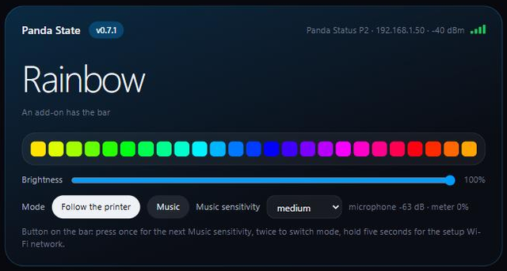
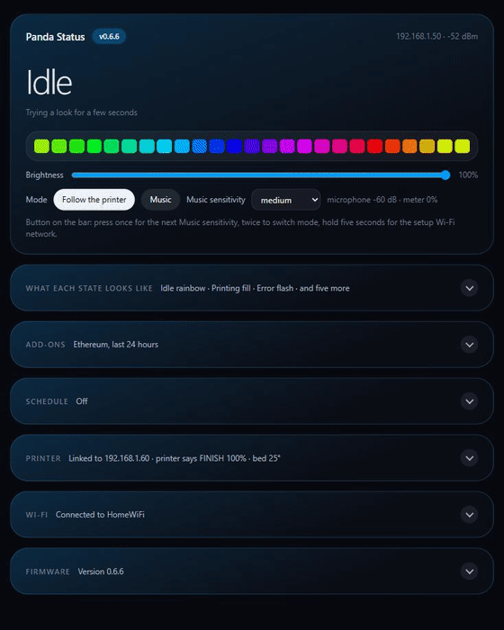
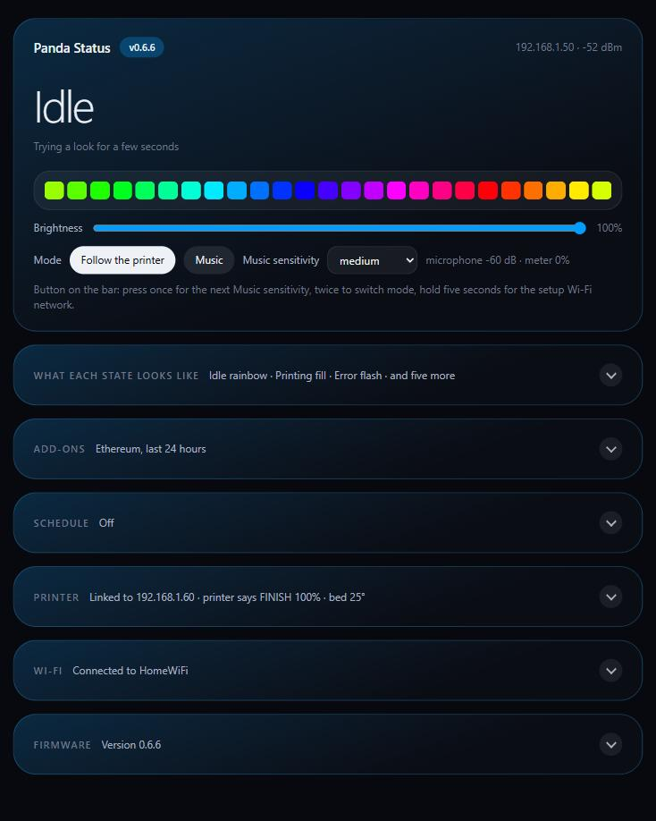
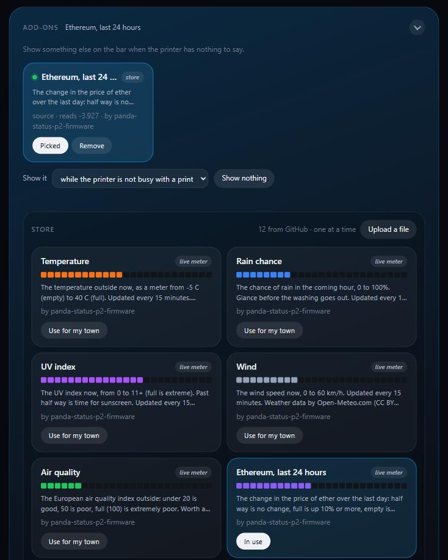
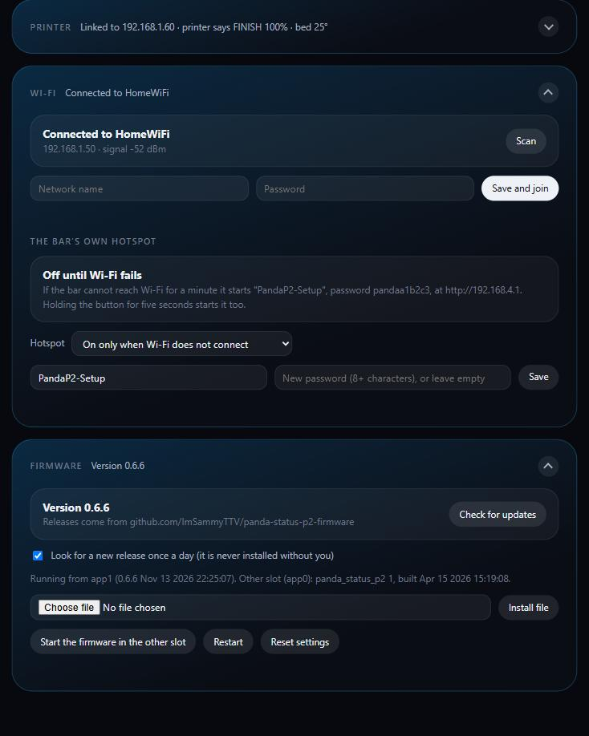

<p align="center">
  
</p>

<p align="center">
  <a href="https://github.com/ImSammyTTV/Panda-State/releases/latest"></a>
  <a href="https://github.com/ImSammyTTV/Panda-State/releases"></a>
  
  <a href="LICENSE"></a>
  <a href="https://ko-fi.com/imsammyttv"></a>
</p>

# Panda State

Open replacement firmware for BIQU's Panda light boards, written for the
**Panda Status P2**, the 25-LED light bar for Bambu Lab **P2S** and **X2D**
printers. It does what stock does, then adds a real cool-down, seventeen
effects, add-ons, Home Assistant, Klipper, updates from GitHub and an open
API.

<p align="center"><sub>Free and open. If it makes your printer nicer to live with, a drink on <a href="https://ko-fi.com/imsammyttv">Ko-fi</a> helps fund the next feature.</sub></p>

> [!WARNING]
> **Unofficial**, and not made or supported by BIQU, BigTreeTech or Bambu Lab.
> Made and tested on the **Panda Status P2**. The builds for the original Panda
> Status, the Panda Lux RGB and the Panda RGB Controller use pins read out of
> BIQU's own firmware for those boards, but **have not been run on that
> hardware yet** (see [Which boards](#which-boards)). **Use at your own risk**
> (see the [disclaimer](#disclaimer)).

<p align="center"></p>

## Highlights

- 🔗 **Pairs with the printer by itself**, and keeps stock's Wi-Fi and pairing: nothing to retype.
- 🖨️ **Bambu Lab or Klipper**: follows a Bambu printer over its LAN link, or any Klipper printer through Moonraker.
- 🏠 **Home Assistant** over MQTT: the bar appears by itself as a light with sensors, ready for automations.
- 🌡️ **A real cool-down** after a print: the bar drains as the bed cools, then says *Ready*.
- 🎨 **Every state restyled**: eight states, each with two colours, one of 17 effects and a speed.
- 🧩 **Add-ons and a store**: weather, rain, UV and air quality for your town, prices, looks, animations.
- ⬆️ **Updates from GitHub**, checked against the release's checksums, installed with one click.
- 📶 **Its own hotspot** when Wi-Fi fails, so you can always reach it.
- 🎵 **Music mode**, a **schedule**, and an **open HTTP API** for your own apps.

## Quick start

1. Find the bar's address (the stock app or your router shows it).
2. Download the file for your board from the [latest release](https://github.com/ImSammyTTV/Panda-State/releases/latest): `panda-p2-custom-<version>.bin` for the Panda Status P2 (the others are in [Which boards](#which-boards)).
3. Open `http://<bar address>/`, find the firmware update section, and upload the file.

The bar restarts into it in a few seconds, on the same Wi-Fi and still paired.
From then on it updates itself: **Firmware → Check for updates → Install**.

## Which boards

All four are ESP32-C3 boards from BIQU. Each has its own image, because the
pins differ and the wrong pins on the wrong board is not something to guess at
start-up. The updater on the bar fetches the right one for itself.

| Board | File | LEDs | Status |
|---|---|---|---|
| **Panda Status P2** | `panda-p2-custom-<v>.bin` | 25 on GPIO 5, microphone, button | ✅ Made and tested on it |
| **Panda Status** (original) | `panda-status-custom-<v>.bin` | WS2812 strip on GPIO 5, length set on the page | 🧪 Not yet run on one |
| **Panda Lux RGB** (PX and PX2) | `panda-lux-custom-<v>.bin` | WS2812 strip on GPIO 5, length set on the page | 🧪 Not yet run on one |
| **Panda RGB Controller** | `panda-rgb-custom-<v>.bin` | Two 12 V RGB channels on PWM (GPIO 10/1/4 and 6/0/5) | 🧪 Not yet run on one |

The pins for the three untested boards were read out of BIQU's own firmware
for each (the LED channel set-up in the original Panda Status V1.0.3, the Lux
RGB V1.0.0 and the RGB Controller V1.0.2), not guessed. What has not happened
yet is anyone running these builds on that hardware. If you do, an issue saying
how it went is very welcome. On those boards:

- **Music mode** is P2-only: it needs the P2's ES8311 microphone.
- **The button** only does the 5-second hold for the hotspot.
- **The original Panda Status and the Lux** show the 25-LED picture stretched
  over however many LEDs the strip has (*What each state looks like → LEDs on
  the strip*).
- **The RGB Controller** shows the bar's average colour on both channels, or
  with *Split the bar* the first half on channel 1 and the second on channel 2.
- **The Lux's white LEDs** are not driven yet: its RGB strip is found, its
  white channel is not.
- They install the same way, through stock's updater. Stock stays in the
  other slot only if those boards use the same two-slot layout as the P2, which
  is likely (same BIQU firmware family) but not checked.

**Not supported: the Panda Vent.** Its board is a different chip (the original
ESP32, not a C3) and its main job is a motor, whose driver and end-stop
sensing would have to be worked out from its firmware before anything could
safely move it.

---

<details>
<summary><b>📸 A tour of the bar's page</b></summary>
<br>

<p align="center"></p>

Every section folds away, and a closed one still says how things are:

<p align="center"></p>

The add-ons, with the store read from this repository:

<p align="center"></p>

Wi-Fi with its hotspot fallback, and updates straight from GitHub:

<p align="center"></p>

*Network names, addresses and passwords replaced with examples.*

</details>

<details>
<summary><b>✨ Everything it does</b></summary>
<br>

- **Pairs with the printer by itself.** Printer address, serial number and
  access code on the bar's page. A bar already paired on stock keeps its
  pairing **and** its Wi-Fi.
- **A real cool-down after a print.** Stock shows a finished print in its own
  green whatever you choose. Here the bar drains as the bed cools and only then
  says *Ready*, with the time and bed temperature you set.
- **Every state restyled.** Idle, printing, paused, finished, cooling, ready,
  error and offline each get two colours, an effect and a speed (stock offers
  three colours).
- **Seventeen effects:** solid, breathe, fill, flash, chase, rainbow, gradient,
  waves, scroll, theatre, scanner, meteor, fire, twinkle, sparkle, rain and
  aurora. *Try* shows any look on the bar for a few seconds.
- **Music mode.** A sound-level meter from the built-in microphone, with low,
  medium, high or auto sensitivity.
- **Schedule.** Dark or dimmed by the clock; the time comes from the internet.
- **Add-ons, with a store.** Show something else when the printer has nothing
  to say: a look, meters, an animation, or a live meter from a web address.
  Pick from the [store](addons/store), upload a file of your own, or have any
  program on your network post to the bar.
- **Updates from GitHub.** The bar finds the newest release here, checks it
  against the release's SHA256 checksums, and installs it on trial. The bar
  itself fills in blue as it goes. An optional daily check only tells you; it
  never installs by itself.
- **Its own hotspot.** After a minute without Wi-Fi the bar starts its own
  network so you can fix its settings; it goes again once Wi-Fi is back. It can
  also stay on, with your own name and password, and the page can scan for
  networks.
- **Klipper as well as Bambu Lab.** Choose *Klipper (Moonraker)* in the
  Printer section and give its address: the bar asks Moonraker every two
  seconds for the job state, progress and bed temperature, and the same
  cool-down applies. A Moonraker API key is optional, for installs that ask
  for one.
- **Home Assistant.** Give it your MQTT broker (the Mosquitto add-on, usually)
  and the bar appears under MQTT devices with no YAML: a light (on, off,
  brightness, colour and effect; *Follow the printer* hands it back), sensors
  for what it is showing, the print's progress and its Wi-Fi signal, and on the
  P2 a Mode select. Automations can also publish `{"state":"printing",
  "progress":42}` to `panda/<id>/state/set`.
- **A controller can drive it.** A home-automation system or script can post
  the printer's state; the bar follows it while it keeps posting.
- **Its own web page**, with a live picture of the 25 LEDs and a Wi-Fi signal
  meter. Works on a phone, needs no internet. The store's cards play each
  add-on as the bar would, from a copy of the bar's own effects.

**The button on the bar:** press once for the next Music sensitivity, twice to
switch between Music and following the printer, hold five seconds to start the
hotspot.

</details>

<details>
<summary><b>🔧 The hardware, and why this is possible</b></summary>
<br>

BIQU publish no source code or schematics for the P2. Their
[product page](https://neo.bttwiki.com/en/docs/panda-series/module/panda-status-p2/)
gives the module, board size and power; the rest was read out of the stock
firmware and confirmed on a working bar. [HARDWARE.md](HARDWARE.md) has every
detail and how it was found.

| | |
|---|---|
| Processor | Espressif **ESP32-C3** (ESP32-C3-MINI): RISC-V, 160 MHz, 400 KB SRAM, 2.4 GHz Wi-Fi |
| Board | 96 × 17 mm, built into the light strip, which sticks to the heated bed |
| Power | USB-C, 5 V (rated 5 V 3 A); 3.3 V logic |
| Flash | 4 MB: two 1.94 MB firmware slots plus settings |
| LEDs | 25 addressable WS2812-style LEDs, GRB, data on GPIO 5 |
| Microphone | ES8311 codec: I2C on GPIO 2/3 (0x18), I2S on GPIO 0/1/4/7/10 |
| Button | GPIO 9 |
| USB-C | CH340 USB-serial bridge (flashing and logs, 115200 baud) |
| Speaker | None found |
| Stock firmware | V1.0.0, ESP-IDF v5.3.1 + ESP-ADF |

It works because:

1. **Nothing is locked.** No secure boot, no flash encryption, no firmware
   signing: the bar runs any valid ESP32-C3 image.
2. **Stock's own updater accepts it.** It writes a new image into the slot that
   is not running, so the custom firmware goes on over Wi-Fi and stock stays
   whole in the other slot.
3. **Every pin could be found** in stock's own set-up code.
4. **The printer talks openly on the LAN**, over MQTT with TLS (port 8883,
   user `bblp`, password = the access code). Its ~31 KB message each second is
   too big for this chip to hold beside a TLS session, so the firmware reads it
   as a stream and keeps only the job state, progress and bed temperature.

</details>

<details>
<summary><b>📥 Installing and updating, in detail</b></summary>
<br>

**First install, from the stock firmware.** Open `http://<bar address>/`, find
the firmware update section, and upload `panda-p2-custom-<version>.bin`. Or
from a terminal:

```sh
curl -X POST http://<bar address>/ota \
     -H "OTA-Type: ota_fw" \
     -H "Content-Type: application/octet-stream" \
     --data-binary @panda-p2-custom-<version>.bin
```

Check the file against the release's `SHA256SUMS.txt` first. The bar restarts
into it within a few seconds, joins the same Wi-Fi and keeps its pairing.

**Updating.** From 0.6.2 the bar updates itself: **Firmware → Check for
updates → Install**. It refuses anything that does not match the release's
checksums, and restarts into it on trial. *Install file* still takes a `.bin`
you downloaded yourself. (0.6.0 and 0.6.1 could not download: install 0.6.2 or
later by hand once.)

**Keeping stock.** Any update goes into the *other* slot, which replaces what is
there, stock included. To keep stock in it, update through stock instead: press
*Start the firmware in the other slot*, then upload the new image through stock
as above.

</details>

<details>
<summary><b>🛟 Staying safe</b></summary>
<br>

- **Two slots.** An update always goes into the slot that is not running.
- **Trial period.** A new build that is not on Wi-Fi within 2 minutes hands the
  bar back to the other slot by itself.
- **Microphone guard.** If starting the microphone ever brings the chip down,
  the next start leaves it off, so the bar stays reachable.
- **Hotspot.** After a minute without Wi-Fi (or a 5 s button hold) the bar
  starts `PandaP2-Setup` (`PandaState-Setup` on the other boards), password `panda` + the last six hex digits of its MAC
  (the page shows it). Join it and open `http://192.168.4.1/`. It cannot be
  switched off for good.
- **Updates are checked.** Downloads must match the release's SHA256 checksum,
  and HTTPS is checked against built-in root certificates, never skipped.
- **Stock's settings are never written**, so going back to stock finds
  everything as it was.

</details>

<details>
<summary><b>↩️ Going back to the stock firmware</b></summary>
<br>

- If stock is still in the other slot: press **Start the firmware in the other
  slot** on this firmware's page.
- Otherwise install `panda-p2-stock-v1.0.0-app.bin` (in every release) with
  **Firmware → Install file**.

That file is BIQU's V1.0.0 application image, unmodified. It holds no Wi-Fi,
printer or other settings (those live elsewhere in the flash) and was checked
for them. It is BIQU's work, not covered by this project's licence, and is here
only for going back: BIQU's own release notes point to a repository that holds
no firmware files.

Back on stock, its own defaults apply: `http://PandaStatus.local`, hotspot
`Panda_Status_P2_…` with password `987654321` at `192.168.254.1`.

If a bar stops answering altogether, reflash it over USB-C with Espressif's
`esptool` (115200 baud): write the stock image to `0x10000` and erase
`otadata` at `0xC000`.

</details>

<details>
<summary><b>🧑‍💻 The API, for your own apps</b></summary>
<br>

JSON in, JSON out, no sign-in (the same as stock: anything on your network can
use it). `GET /api` returns this list.

| Call | Body | What it does |
|---|---|---|
| `GET /api/status` | | Everything: what is showing and why, printer link, microphone, clock, add-ons, settings, the 25 LEDs |
| `GET /api/frame` | | Just the 25 LED colours, as 150 hex digits |
| `POST /api/state` | `{"state":"printing","progress":42}` | A controller saying what the printer is doing; repeat at least every 45 s |
| `POST /api/addon` | see below | A program saying what it wants shown |
| `POST /api/addonfile` | `{"url":"https://…"}`, `{"file":{…}}`, `{"remove":true}` | An add-on the bar runs itself ([format](addons/store/README.md)) |
| `POST /api/config` | any subset of the settings | `brightness`, `mode`, `music.sensitivity`, `states.<state>.{colour,colour2,effect,speed}`, `cool.{minutes,target}`, `schedule.{…}`, `time.{tz,zone}`, `addon.{show,when}`, `order`, `reversed`; `stripLength` (original Panda Status and Lux), `split` (RGB Controller) |
| `POST /api/preview` | `{"state":"cooling","progress":60,"seconds":8}` | Show a look for a few seconds |
| `POST /api/printer` | `{"ip":"…","serial":"…","code":"…"}` | Pair with a Bambu printer; `{"forget":true}` unpairs. The code is never sent back out |
| `POST /api/printer` | `{"type":"klipper","host":"…","port":7125,"key":"…"}` | Follow a Klipper printer through Moonraker instead; the key is optional and never sent back |
| `POST /api/ha` | `{"on":true,"host":"…","port":1883,"user":"…","password":"…","prefix":"homeassistant"}` | Home Assistant over MQTT; anything left out is kept, the password is never sent back |
| `POST /api/update` | `{"check":true}`, `{"install":true}`, `{"auto":true}` | Updates from GitHub |
| `POST /api/wifi` | `{"ssid":"…","password":"…"}` | Save Wi-Fi and restart |
| `GET /api/wifi/scan` | | Networks in range |
| `POST /api/ap` | `{"always":false,"ssid":"…","password":"…"}` | The hotspot |
| `POST /api/slot`, `/api/reboot`, `/api/factory` | | Other slot; restart; clear settings |
| `POST /update` | multipart file | Install a `.bin` into the other slot |

States: `idle`, `printing`, `paused`, `finished`, `cooling`, `ready`, `error`, `off`.

</details>

<details>
<summary><b>🧩 Writing an add-on</b></summary>
<br>

**As a file** the bar runs itself (a look, meters, an animation, or a live meter
from a web address): see the [store's README](addons/store/README.md) for the
format, and upload it from the page or add it to the store.

**As a program** anywhere on your network: post what to show, and keep posting.
Each post lapses after its `ttl` (seconds), so a program that stops is dropped by
itself. Send **one** of these with an `id`, and optionally `name` and `ttl`:

```json
{"id":"demo","name":"Demo","look":{"colour":"#8000FF","effect":"breathe","speed":40}}
{"id":"demo","name":"Demo","meters":[{"value":63,"colour":"#D97757"},{"value":20,"colour":"#3B82F6"}]}
{"id":"demo","name":"Demo","frame":["#FF0000","#FF0000","… 25 colours in all …"]}
```

`{"id":"demo","remove":true}` withdraws it. The answer's `"picked"` says whether
yours is the one the owner chose.

```sh
curl -X POST http://<bar address>/api/addon -H "content-type: application/json" \
     -d '{"id":"demo","name":"Demo","meters":[{"value":63,"colour":"#D97757"}]}'
```

`addons/meter.py` turns any command that prints a number from 0 to 100 into a
meter:

```sh
python3 addons/meter.py --bar 192.168.1.50 --id disk --name "Disk used" \
    --command "df --output=pcent / | tail -1 | tr -dc 0-9"
```

</details>

<details>
<summary><b>🛠️ Building from source</b></summary>
<br>

PlatformIO, Arduino framework for ESP32-C3 (`espressif32@6.9.0`):

```sh
cd firmware
pio run              # Panda Status P2: .pio/build/panda/firmware.bin
pio run -e status    # original Panda Status
pio run -e lux       # Panda Lux RGB (PX, PX2)
pio run -e rgb       # Panda RGB Controller
```

`firmware/partitions.csv` is the stock table, unchanged, so stock and custom can
sit side by side. The image must stay under 1.94 MB.

</details>

---

## Disclaimer

Provided **as is**, without warranty of any kind. Installing third-party
firmware may void your warranty and can leave a device unusable. **The authors
accept no responsibility or liability** for any damage, loss, injury, failed
prints or other consequence of using, installing or being unable to use this
firmware or the stock image included with it. You alone decide whether to use
it.

BIQU, BigTreeTech, Panda Status, Panda Lux, Panda Vent, Bambu Lab, P2S, X2D,
Klipper and Home Assistant are trademarks of their owners, used here only to
say which hardware and software this works with.

## Licence

The firmware, its page and the add-on script are [MIT licensed](LICENSE). The
stock firmware image in the releases is BIQU's and is not covered by it.
