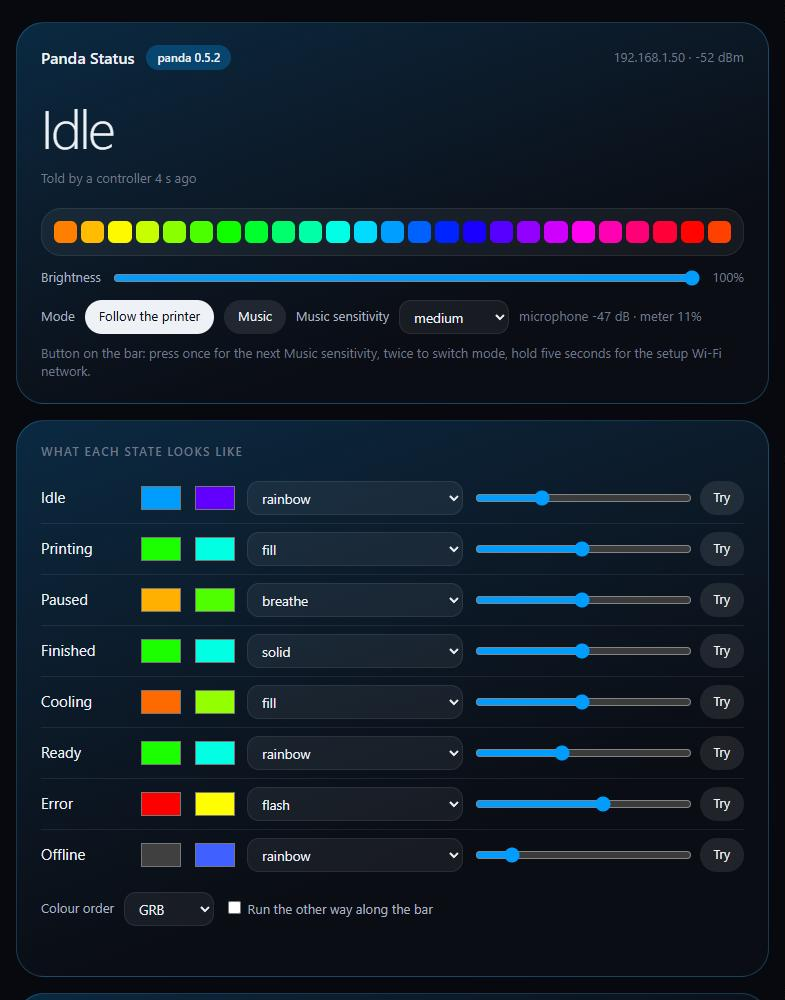
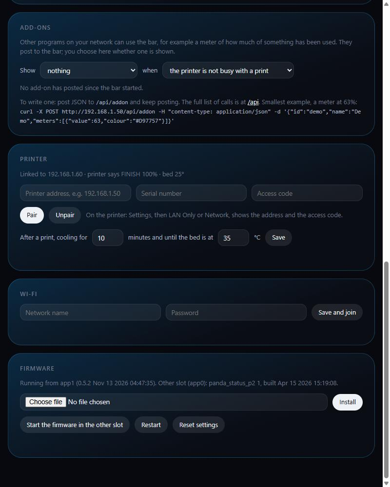

<p align="center">
  
</p>

<p align="center">
  <a href="https://github.com/ImSammyTTV/panda-status-p2-firmware/releases/latest"></a>
  <a href="https://github.com/ImSammyTTV/panda-status-p2-firmware/releases"></a>
  
  <a href="LICENSE"></a>
  <a href="https://ko-fi.com/imsammyttv"></a>
</p>

# Custom firmware for the BIQU Panda Status P2

<p align="center"><sub>Free and open. If it makes your printer nicer to live with, a drink on <a href="https://ko-fi.com/imsammyttv">Ko-fi</a> helps fund the next feature.</sub></p>

An open, replacement firmware for the **BIQU (BigTreeTech) Panda Status P2**,
the 25-LED status light bar for Bambu Lab P2S and X2D printers. It keeps what
the stock firmware does, adds a proper cool-down state, seventeen lighting
effects, a schedule, Music mode, a clean web page, and an open HTTP API so
anything on your network can use the bar.



> **Read this first.**
> - This is **unofficial**. It is not made, endorsed or supported by BIQU,
>   BigTreeTech or Bambu Lab.
> - It is written for the **Panda Status P2** only. It has **not been tested
>   on the original Panda Status** (the earlier model) or any other device, and
>   is not expected to work there. Do not install it on anything else.
> - **You use it entirely at your own risk.** See [Disclaimer](#disclaimer).

---

## What it does

- **Pairs with the printer by itself.** Printer address, serial number and
  access code on the bar's page. A bar that was already paired on the stock
  firmware keeps its pairing **and** its Wi-Fi: nothing to type after the
  update.
- **A real cool-down after a print.** Stock shows a finished print in its own
  green no matter what. Here the bar drains as the bed cools and only then says
  *Ready*, with the time and bed temperature you choose.
- **Every state restyled.** Idle, printing, paused, finished, cooling, ready,
  error and offline each get their own two colours, effect and speed. Stock
  offers three colours.
- **Seventeen effects:** solid, breathe, fill, flash, chase, rainbow, gradient,
  waves, scroll, theatre, scanner, meteor, fire, twinkle, sparkle, rain and
  aurora. Two-colour effects work out a second colour from the first unless you
  pick one. A *Try* button shows any look on the bar for a few seconds.
- **Music mode.** A sound-level meter from the bar's built-in microphone, blue
  through green, yellow and orange to red, with low / medium / high / auto
  sensitivity.
- **Schedule.** Dark (or dimmed) by the clock, e.g. 9 pm to 9 am. Time comes
  from the internet; the time zone is picked on the page.
- **Add-ons, with a store.** Show something else on the bar when the printer
  has nothing to say: a look, meters, an animation, or a live meter read from a
  web address (a price, a usage figure). Pick one from the
  [store](addons/store) on the bar's page, upload a file of your own, or have
  any program on your network post to the bar. A store add-on is fetched from
  GitHub when the bar starts; only its address is kept on the bar.
- **Updates from GitHub.** *Check for updates* on the bar's page finds the
  newest release here, and *Install* downloads it, checks it against the
  release's SHA256 checksums and installs it, with the same trial-and-rollback
  safety as any update. An optional daily check tells you when there is one; it
  never installs by itself.
- **Its own hotspot when Wi-Fi fails.** After a minute without Wi-Fi the bar
  starts its own network so you can reach it and fix the settings, and it
  goes away again once Wi-Fi is back. It can be kept on all the time, and its
  name and password changed. The Wi-Fi card can scan for networks.
- **A controller can drive it.** Something that knows more than the bar (a
  home-automation system, a script) can post the printer's state; the bar
  believes it while it keeps posting, then falls back to its own printer link.
- **Its own web page** at `http://<bar address>/` with a live picture of the 25
  LEDs. It works on a phone and needs no internet.
- **Recoverable by design.** See [Staying safe](#staying-safe).

The button on the bar: press once for the next Music sensitivity, twice to
switch between Music and following the printer, hold for five seconds to start
the setup Wi-Fi network.



*(Screenshots from a running bar; network addresses replaced with examples.)*

## The hardware, and why this is possible

BIQU publish no source code or schematics for the P2. Their
[product page](https://neo.bttwiki.com/en/docs/panda-series/module/panda-status-p2/)
gives the module, board size and power; everything else below was read out of
the stock firmware itself and then confirmed on a working bar.
[HARDWARE.md](HARDWARE.md) has every detail and how each was established.

| | |
|---|---|
| Processor | Espressif **ESP32-C3** (an ESP32-C3-MINI module): 32-bit RISC-V, single core, 160 MHz, 400 KB SRAM, 2.4 GHz Wi-Fi |
| Board | 96 × 17 mm control board built into the light strip, which sticks to the printer's heated bed |
| Power | USB-C, 5 V (BIQU rate it at 5 V 3 A); 3.3 V logic |
| Flash | 4 MB, split into two 1.94 MB firmware slots (`app0`, `app1`) plus settings |
| LEDs | 25 addressable WS2812-style LEDs, GRB colour order, data on GPIO 5 |
| Microphone | ES8311 audio codec: I2C on GPIO 2/3 (address 0x18), I2S on GPIO 0/1/4/7/10 |
| Button | One push button on GPIO 9 |
| USB-C | CH340 USB-serial bridge (for flashing and logs, 115200 baud) |
| Speaker | None found: a test tone at every volume made no sound |
| Stock firmware | V1.0.0, ESP-IDF v5.3.1 + ESP-ADF |

It works because:

1. **Nothing is locked.** The ESP32-C3 has no secure boot, no flash encryption
   and no firmware signing switched on. The bar will run any valid ESP32-C3
   image.
2. **Stock's own updater accepts it.** The stock web page's firmware update
   (`POST /ota`) writes a new image into the slot that is *not* running and
   boots it. The custom firmware goes on over Wi-Fi, no cable, and the stock
   firmware stays intact in the other slot.
3. **Every pin could be found.** The stock firmware's own set-up code says which
   pins drive the LEDs, the microphone and the button, so this firmware drives
   the same hardware the same way.
4. **The printer talks openly on the LAN.** Bambu printers publish their state
   over MQTT (TLS, port 8883, user `bblp`, password = the access code). A P2S or
   X2D sends a message of about 31 KB every second, far more than this chip can
   buffer next to a TLS session, so the firmware reads it as a stream and picks
   out just the job state, progress and bed temperature as they go past.

## Installing

You need: a Panda Status P2 on your Wi-Fi, its IP address (the stock app or
your router shows it), and `releases/panda-p2-custom-0.6.2.bin`.

**From the stock firmware's page:** open `http://<bar address>/`, find the
firmware update section, choose `panda-p2-custom-0.6.2.bin` and upload it.

**Or from a terminal:**

```sh
curl -X POST http://<bar address>/ota \
     -H "OTA-Type: ota_fw" \
     -H "Content-Type: application/octet-stream" \
     --data-binary @releases/panda-p2-custom-0.6.2.bin
```

The bar restarts into the new firmware within a few seconds, joins the same
Wi-Fi and keeps its printer pairing. Open `http://<bar address>/` again: the
page now says *Panda 0.6.2*.

Check the download against `releases/SHA256SUMS.txt` first.

### Updating later

From 0.6.0 the bar updates itself: open its page, **Firmware → Check for
updates**, then **Install**. It downloads the newest release from this
repository, refuses it unless it matches the release's `SHA256SUMS.txt`, and
restarts into it on trial. (*Install file* still takes a `.bin` you have
downloaded yourself.)

Either way the new firmware goes into the other slot, which **replaces whatever
is kept there, the stock firmware included**. To keep stock in the other slot,
update through stock instead: press *Start the firmware in the other slot* (the
bar restarts into stock), then upload the new image through stock as above.

## Staying safe

- **Two slots.** An update always goes into the slot that is not running.
- **Trial period.** A new build is "on trial" until it has been on Wi-Fi for
  20 seconds. If it is not on Wi-Fi within 2 minutes of starting, it hands the
  bar back to the other slot by itself.
- **Microphone guard.** If starting the microphone ever brings the chip down,
  the next start leaves it off, so the bar stays reachable for an update.
- **Hotspot.** With no Wi-Fi for a minute (or after a 5 s button hold) the bar
  starts its own network, `PandaP2-Setup` unless you renamed it, password
  `panda` followed by the last six hex digits of its MAC address unless you
  changed it (the page shows the default). Join it and open
  `http://192.168.4.1/`. It cannot be switched off for good, so the bar can
  always be reached without a cable.
- **Updates are checked.** A firmware downloaded by the bar must match the
  release's SHA256 checksum, and HTTPS is checked against built-in root
  certificates, never skipped.
- **Stock's settings are never written.** The firmware reads stock's saved
  Wi-Fi and printer pairing once and keeps its own settings separately, so going
  back to stock finds everything as it was.

## Going back to the stock firmware

- If you installed through stock, stock is still in the other slot: on this
  firmware's page press **Start the firmware in the other slot**.
- Otherwise install `releases/panda-p2-stock-v1.0.0-app.bin` from this
  firmware's page (*Firmware → Install*). The bar restarts into stock V1.0.0.

The stock image here is BIQU's V1.0.0 application image, exactly as it came
off a P2, unmodified. It is the **application only**: it contains no Wi-Fi
network, password, printer details or any other settings (those live in a
separate part of the flash, which is not included), and it has been checked
for them. It is BIQU's work, not covered by this project's licence, and is
here only so a bar can be returned to stock: BIQU's release notes link
V1.0.0 to their `Panda_Status_P2` repository, but at the time of writing that
repository holds no firmware files.

Back on stock, the bar's own defaults apply where it has nothing saved: host
name `PandaStatus` (`http://PandaStatus.local`), setup hotspot
`Panda_Status_P2_…` with password `987654321` at `192.168.254.1`, and white /
white / red for idle / printing / error (from BIQU's documentation).

If a bar ever stops answering on the network altogether, it can be reflashed
over its USB-C port with Espressif's `esptool` (115200 baud): write the stock
image to `app0` at `0x10000` and erase `otadata` at `0xC000` so it boots from
there.

## The API: building your own apps

Everything the page does goes through a small JSON API, with no sign-in,
the same as stock: anything on your network can use it. `GET /api` returns the
list below as JSON.

| Call | Body | What it does |
|---|---|---|
| `GET /api/status` | | Everything: what is showing and why, printer link, microphone level, clock, add-ons, settings, the current 25-LED frame |
| `POST /api/state` | `{"state":"printing","progress":42}` | A controller saying what the printer is doing. Repeat at least every 45 s; when it stops, the bar's own printer link takes over |
| `POST /api/addon` | see below | An add-on saying what it wants shown |
| `POST /api/config` | any subset of the settings | `brightness`, `mode`, `music.sensitivity`, `states.<state>.{colour,colour2,effect,speed}`, `cool.{minutes,target}`, `schedule.{enabled,from,to,level}`, `time.{tz,zone}`, `addon.{show,when}`, `order`, `reversed` |
| `POST /api/preview` | `{"state":"cooling","progress":60,"seconds":8}` | Show a look for a few seconds without it counting as the printer's state |
| `POST /api/printer` | `{"ip":"…","serial":"…","code":"…"}` | Pair with a printer; `{"forget":true}` unpairs. The access code is never sent back out |
| `POST /api/addonfile` | `{"url":"https://…"}`, `{"file":{…}}` or `{"remove":true}` | An add-on the bar runs itself (see [the store's README](addons/store/README.md) for the format). Shown as soon as it loads |
| `POST /api/update` | `{"check":true}`, `{"install":true}`, `{"auto":true}` | Look for a newer release on GitHub, install it, or switch the daily check on or off. Progress is in `/api/status` → `update` |
| `POST /api/wifi` | `{"ssid":"…","password":"…"}` | Save Wi-Fi and restart to join |
| `GET /api/wifi/scan` | | Networks in range (the first call starts the scan; ask again for the list) |
| `POST /api/ap` | `{"always":false,"ssid":"…","password":"…"}` | The bar's own hotspot: on only when Wi-Fi fails (default) or always; its name and password |
| `POST /api/slot` | | Restart into the firmware in the other slot |
| `POST /api/reboot`, `POST /api/factory` | | Restart; clear this firmware's own settings |
| `POST /update` | multipart file | Install a `.bin` into the other slot and restart into it |

States: `idle`, `printing`, `paused`, `finished`, `cooling`, `ready`,
`error`, `off`.

### Add-ons

An add-on is a program anywhere on your network, not code on the bar. It posts
what it wants shown and keeps posting; each post lapses after its `ttl`
(seconds), so a script that stops is dropped by itself. The owner picks on the
page which add-on is shown, and when.

Send **one** of these, with an `id` and optionally a `name` and `ttl`:

```json
{"id":"demo","name":"Demo","look":{"colour":"#8000FF","effect":"breathe","speed":40,"progress":100}}
{"id":"demo","name":"Demo","meters":[{"value":63,"colour":"#D97757"},{"value":20,"colour":"#3B82F6"}]}
{"id":"demo","name":"Demo","frame":["#FF0000","#FF0000","… 25 colours in all …"]}
```

- `look`: any of the effects above, as if it were a printer state.
- `meters`: one to four bars sharing the strip, each a value from 0 to 100.
- `frame`: all 25 LEDs set directly (or one string of 150 hex digits). Post
  again to animate.
- `{"id":"demo","remove":true}` withdraws it.

The answer includes `"picked"`: whether yours is the add-on the owner chose.

A meter at 63%, from any terminal:

```sh
curl -X POST http://<bar address>/api/addon -H "content-type: application/json" \
     -d '{"id":"demo","name":"Demo","meters":[{"value":63,"colour":"#D97757"}]}'
```

`addons/meter.py` is a ready-made add-on: give it any command that prints a
number from 0 to 100 and it keeps the bar up to date.

```sh
python3 addons/meter.py --bar 192.168.1.50 --id disk --name "Disk used" \
    --command "df --output=pcent / | tail -1 | tr -dc 0-9"
```

## Building from source

PlatformIO, Arduino framework for ESP32-C3 (`espressif32@6.9.0`):

```sh
cd firmware
pio run            # result: .pio/build/panda/firmware.bin
```

The partition table in `firmware/partitions.csv` is the stock one, unchanged,
so stock and custom can sit side by side. The image must stay under 1.94 MB.

## Disclaimer

This firmware is provided **as is**, without warranty of any kind, express or
implied. Installing third-party firmware may void your warranty and can leave
a device unusable. **The authors accept no responsibility or liability** for
any damage, loss, injury, missed or failed prints, or any other consequence of
using, installing or being unable to use this firmware or the stock image
included here. You alone are responsible for deciding whether to use it.

BIQU, BigTreeTech, Panda Status, Bambu Lab, P2S and X2D are trademarks of their
respective owners and are used here only to say which hardware this is for.

## Licence

The firmware source, the page and the add-on script are released under the
[MIT licence](LICENSE). The stock firmware image in `releases/` is BIQU's and is
not covered by it.
